# Engine1999

A 2D game engine in C (SDL2) that behaves like a home computer of the late 1980s and early 1990s, and comes with its own BASIC to program it.
You type a program, `RUN` it, and it can use an 80x25 text screen, a tile layer, sprites and a free-drawing graphics layer, a software synthesizer, files and devices.
When it is done, `BUILD` turns it into a standalone executable.


> **Status: work in progress.** The engine and the language are still changing (statements may be renamed or reworked before a 1.0), and there are rough edges, but it is
> usable today, and the demos below show what it can do. If you like retro computing, BASIC or small games, you may find it useful already. Open work is listed in
> [docs/roadmap.md](docs/roadmap.md).

## What you get

- **A BASIC with line numbers and labels**, structured when you want it: `IF`/`ELSE`, `FOR`/`NEXT` (also `DOWNTO` and `FOR EACH`), `WHILE`, `REPEAT`, `EXIT`, `ITERATE`,
  procedures and functions with local variables and recursion (`PROC`, `FUNC`, `CALL`), `ON ERROR`/`RESUME`, `AFTER`/`EVERY` timers, `DATA`/`READ`, arrays up to six dimensions,
  binary-safe strings, `` `shell commands` `` as string literals. The whole syntax fits on one page: [docs/grammar.html](docs/grammar.html) ([text version](docs/grammar.md)).
- **Five display layers:** background, tiles, graphics, text and sprites, each with its own palette. Lines, circles, flood fill, `DRAW` strings, pictures defined in the program text
  with `DESIGN`, sprites with animation and collision detection, smooth scrolling. See [docs/graphics-subsystem.md](docs/graphics-subsystem.md).
- **Sprite groups, paths and pictures:** one sprite can be a block of several (`SPRITE n,SIZE 3,3`) that moves and collides as one object, sprites can follow a path string on their own (`SPRITE n,PATH "..."`, with events), and pictures load and save as BMP files (`GFX LOAD`, `SPRITE SAVE`, ...).
- **Sound:** a sixteen channel stereo synthesizer (8 music, 8 effects). Besides the basic waves (sine, square, triangle, noise) it has **instruments**: 28 factory presets (bass, lead, pad, pluck, organ, strings, brass, flute, bell, drums, electric piano, distorted guitar, marimba, harp, ...) and 32 slots of your own, built from up to three oscillators with a filter, envelopes, FM, vibrato and polyphony (`INSTRUMENT 40,"OSC SAW 0.8; FILTER 3 0.3; ENV 0.01 0.2 0.6 0.3"`). `PLAY "T120 I5 O4 CDEFG [ACE]1"` plays music strings (instrument selection, chords, panning with `Y`, filter sweeps with `K`), `SOUND` and `SFX` make effects, `PAN` and `CUTOFF` shape a channel while it plays. See [docs/sound.md](docs/sound.md).
- **Files and devices:** `OPEN`, `PRINT #`, `LINE INPUT`, random access records, and drivers addressed like `mem:`, `sh:`, `tcp:`, `res:`. See [docs/io-subsystem.md](docs/io-subsystem.md).
- **Mouse, keyboard and game controllers:** `MOUSE(...)`, `KEY("name")` (is a key held right now?), `JOY(...)` for up to four pads, with `ON MOUSE`, `ON KEY` and `ON JOY` handlers. See [docs/controller-support.md](docs/controller-support.md).
- **A UI toolkit and editors:** the `UI` statements give buttons, lists, sliders, scroll bars, overlapping windows and a pixel canvas; a file requester, tabs, a character grid and more; the editors for sprites and tiles, fonts, music, sound effects, instruments and a pattern **tracker** are written in BASIC on top of it (`tools/spriteed.bas`, `fonted.bas`, `musiced.bas`, `sfxed.bas`, `insted.bas`, `tracker.bas`; start one from the prompt with `TOOL "spriteed"`, your program stays). See [docs/ui-subsystem.md](docs/ui-subsystem.md).
- **Libraries:** `LOAD LIBRARY "name"` pulls in a shared BASIC library (the games share `util`, `input`, `text`, `hiscore`, `uikit`, ...); `BUILD` embeds them. See [docs/library-support.md](docs/library-support.md).
- **Safe by default:** a running program may use the files below its own folder; anything else (other folders, shell commands, the network) asks first, and the answer can be remembered. Listings can be UTF-8. See [docs/security-policy.md](docs/security-policy.md).
- **Selection and the clipboard in the editors:** the full-screen editor selects with Shift and the arrows or the mouse and copies, cuts and pastes through the system clipboard (the terminal's in the console version); BASIC programs get `CLIPBOARD$` / `CLIPBOARD a$` and a multi-line text editor widget (`UI EDIT`); `EDIT WINDOW` opens the program in a window editor built on it (`demos/notepad.bas` is a small text editor in BASIC).
- **Screenshots:** the **Print** key (or Ctrl+Shift+P) saves the picture as a BMP file in the current directory, and `SCREENSHOT "name"` does the same from a program.
- **Tools built in:** a full-screen editor (`EDIT`), a machine monitor with single-step and breakpoints (`MONITOR`), syntax colored `LIST`, `TRACE`, `STOP`/`CONT`, `RENUM`, `MERGE`, `CHAIN`.
- **`BUILD "name"`** makes a standalone Linux executable from your program (details below).
- **`engine1999c`**, a console version without a window for shell scripts and pipes: `engine1999c prog.bas` (also with a `#!` line), `echo 'PRINT 2^10' | engine1999c`, exit codes with `BYE n`. See [docs/console-host.md](docs/console-host.md).

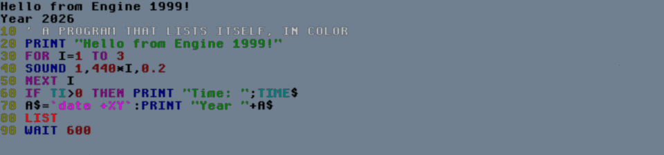

### Edit, look around, debug

`EDIT` opens a **full-screen text editor** for the whole program: line numbers in their own pane, syntax colors, a scroll bar, a help bar. It works with the keyboard
(cursor keys, PgUp/PgDn, Ctrl+Home/End, Ctrl+Y deletes a line) and with the **mouse**: click into the text to put the cursor there, turn the wheel, click or hold the arrows of the
scroll bar, drag its thumb. The same editor runs in the console version, in a terminal.

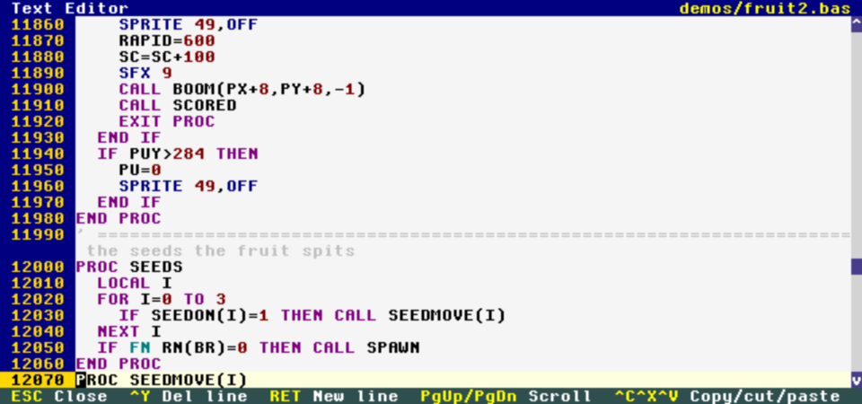

At the `Ready.` prompt the **screen itself is the editor**, like on a Commodore 64: `LIST` something, move the cursor up into the listing, change a line and press RETURN to enter it.
The red status line shows the mode (overwrite or insert, F12 switches), the position and the BASIC line number; the screen rows of the line under the cursor are highlighted.

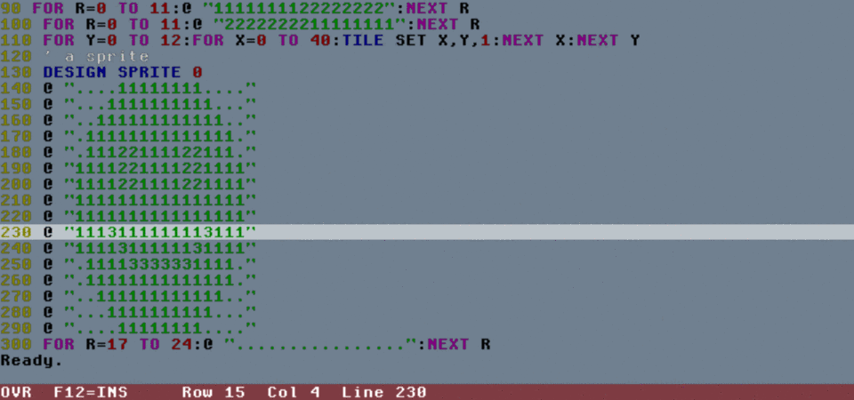

`MONITOR` opens a **machine monitor** for the virtual machine your program is compiled to: disassemble, dump and patch memory, set breakpoints, step through the code and watch the stacks.

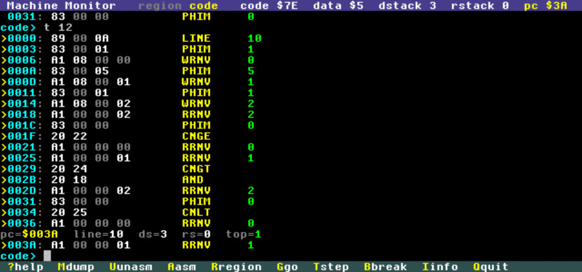

Select text with Shift and the cursor keys or the mouse, copy, cut and paste with Ctrl+C / X / V (the system clipboard; Ctrl+Insert, Shift+Delete and Shift+Insert as well; in the console version the terminal's):

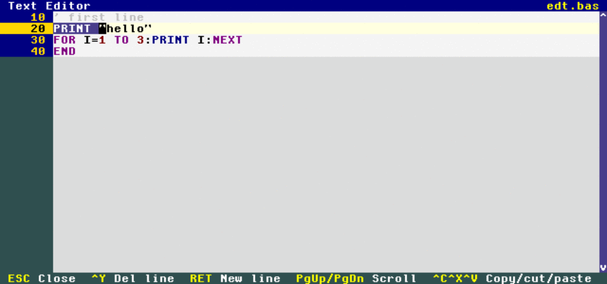

`EDIT WINDOW` edits the program in a window in the UI toolkit, with the same syntax colors as `LIST` (`ENGINE1999_UITHEME=dark` gives a dark theme), and `demos/notepad.bas` shows the same editor widget in a small text editor written in BASIC:

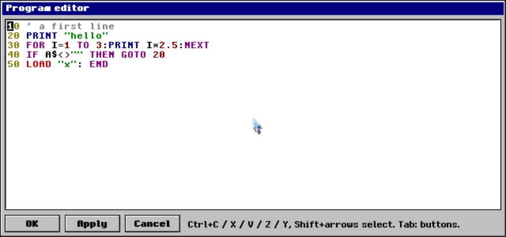

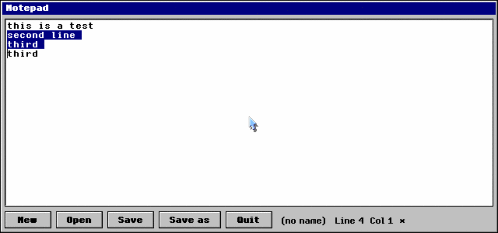

The sprite and tile editor, itself a BASIC program built on the UI statements, imports and exports BMP files:

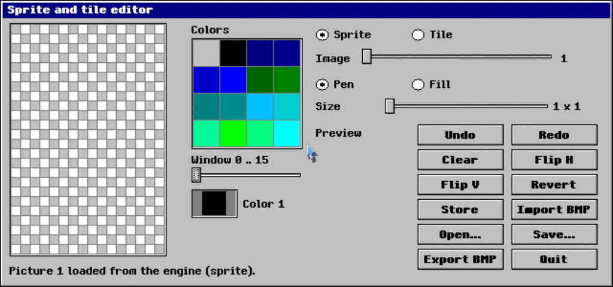

### Tools: edit while the program waits

The editors are *tools* (the `tools/` folder): `TOOL "spriteed"` runs one without losing the program you are working on, as on the home computers of old, where you stopped a game, changed its sprites and went on. Here `orchard2` is running; ESC stops it, `TOOL "spriteed"` opens the sprite editor on the pictures the game has loaded (the cherry is picture 1), a few pixels get a new color, and Store puts the picture back into the engine:

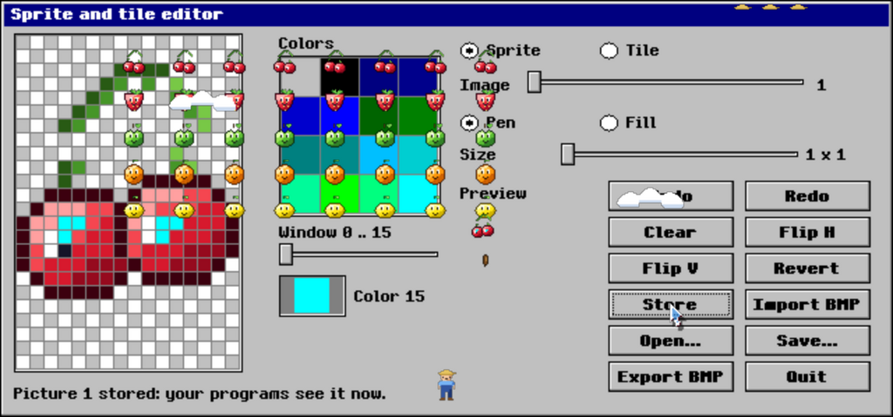

Quit returns to the prompt with the game's graphics and variables untouched, and `CONT` goes on playing:

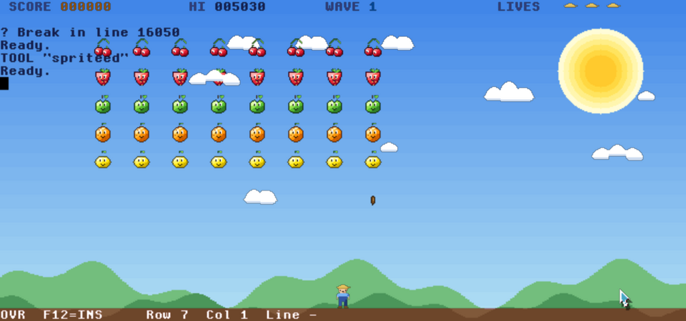

`TOOL "fonted"` is the font editor for the text screen font (the characters `SYMBOL` redefines): a table of all 256 characters, an 8 x 12 grid, every stroke goes to the engine at once. Here the letter K has become a chess king (loaded from a file of `DESIGN CHAR` lines; Save writes such files):

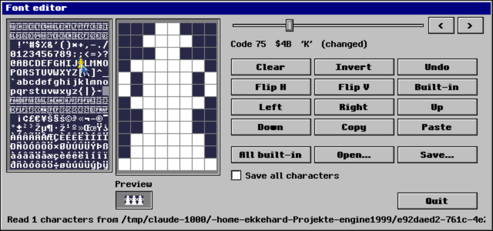

The font stays changed when the tool ends:

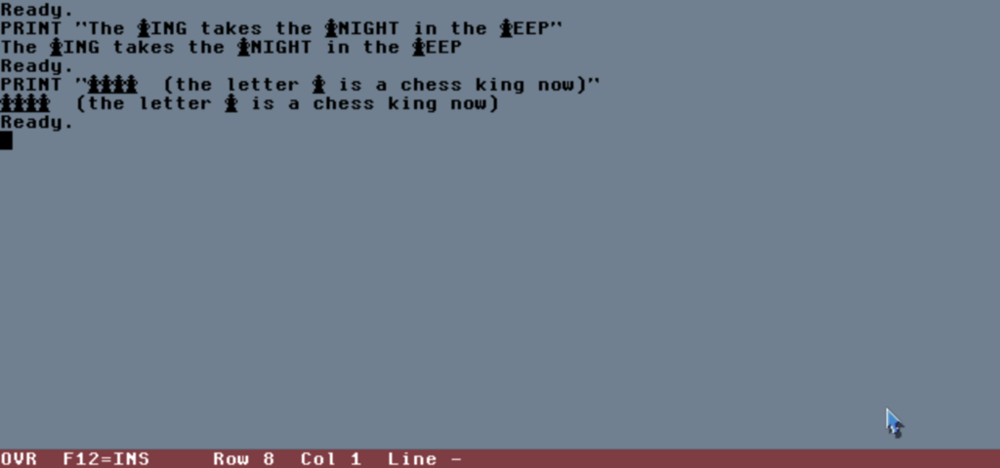

### Sound: instruments, a tracker, a demo with a soundtrack

The **instrument editor** (`TOOL "insted"`) shows every parameter of an instrument as a slider: three oscillators with ratio, detune, pulse width and FM, a filter with its own envelope, a pitch envelope, vibrato, polyphony. Notes sound while you move the sliders, and *Export* writes the `INSTRUMENT` line for your program:

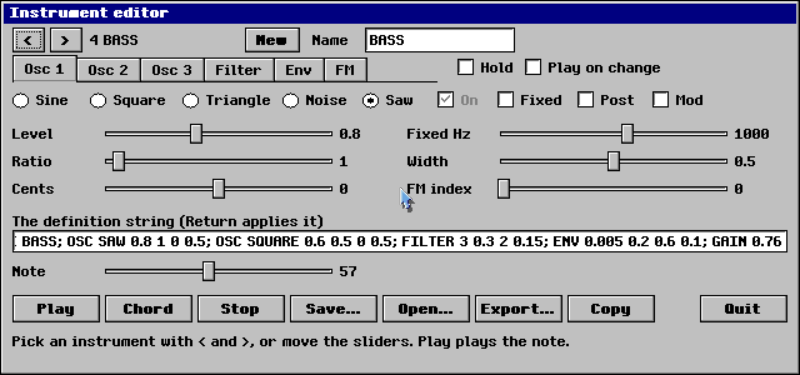

The **tracker** (`TOOL "tracker"`) is a pattern based music editor for up to eight channels: type notes with the piano keys, change the song while it plays, loop a pattern or the whole song, and export the song as `PLAY` strings for your own programs. `demos/groove.trk` is a small song to start with:

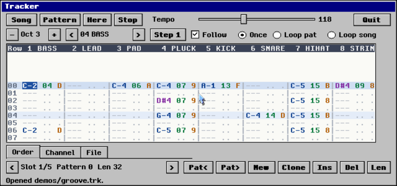

**Y2K38** is the sequel to the Y2K Countdown demo: a two minute megademo about the day in 2038 when a signed 32 bit clock runs over. Its dark industrial soundtrack is made by the program itself from the synthesizer's instruments, and the pictures show the 3D sector renderer (a flight through a server room), sprites on paths, a picture written to a BMP file and loaded back, and plenty of palette tricks:

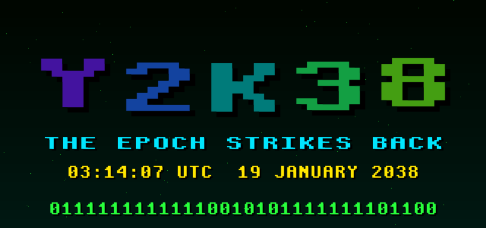

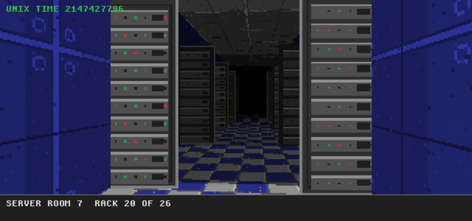

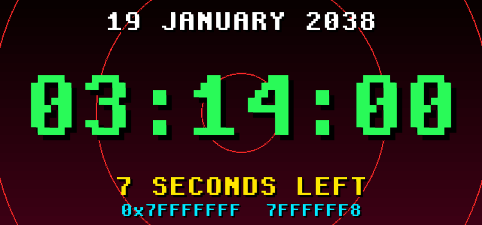

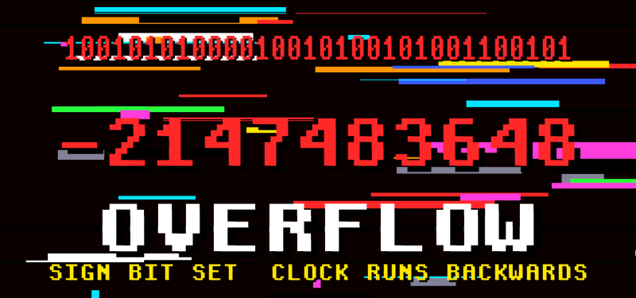

## Try it

You need Linux, `gcc`, `make` and the SDL2 development files (on Debian and Ubuntu: `sudo apt install build-essential libsdl2-dev`). It is developed and tested on Debian 12 on x86-64.

```
make
./engine1999
```

`sudo make install` puts the programs, the demos, the documentation and the man pages (`man engine1999`, `man engine1999c`, `man engine1999-basic`) under `/usr/local`; with it, `BUILD` works from any directory. The programs get **icons and entries in the desktop's application menu** (the games under *Games*, `engine1999` under *Development*, the Y2K demo under *Sound & Video*).

You get a `Ready.` prompt, like a home computer of old. Type a program (ESC stops a running one):

```
10 PRINT "Hello from Engine 1999!"
20 FOR I=1 TO 3
30   SOUND 1,440*I,0.2
40 NEXT I
RUN
LIST
SAVE "hello"
```

Then try the demos: `LOAD "demos/orchard2"` and `RUN`. After `make install` the games are programs of their own (and `engine1999-wumpus`, a text game for any terminal): `engine1999-orchard`, `-orchard2`, `-orchard3`, `-climb`, `-climb2`, `-madrun`, `-madrun2`, `-river`, `-river2`, `-rustinpeace`, `-glyphminer` and `-deqq` (each with a manual page, e.g. `man engine1999-rustinpeace`).

| Demo | |
|---|---|
| `demos/orchard2.bas` | **Orchard Defense II**: a gardener throws balls at marching fruit under a sunny sky with drifting clouds, hills and a sun; shaded sprites, a bird, round bushes, music and effects (keys: A/D walk, SPACE throws, P pauses, Q quits) |
| `demos/climb.bas` | **The Long Climb**, a jump and run game: climb a steel tower, drill holes to trap monsters, reach the ice cream stand on the roof |
| `demos/orchard3.bas` | **Orchard Defense III**: the top-notch edition for one or two players: a day that passes (dawn to night), wind, swaying fruit, coconuts, a balloon that drops power-ups, and a giant melon that splits in two every fifth wave |
| `demos/climb2.bas`, `demos/madrun2.bas`, `demos/river2.bas` | Second editions of the games with new graphics: a giant ice cream cone and falling bolts, a traffic helicopter and pigeons, a hot air balloon and gulls |
| `demos/madrun.bas` | **MADRUN**: a crossing game for one to four players, with a phone booth, traffic and a rescue ambulance |
| `demos/river.bas` | **ETERNAL RIVER**: a scroll-down boat game over an endless river, with bridges, swimmers and wraiths on the banks |
| `demos/deqq.bas` | **DEQQ'S HOUSE**: a graphics adventure: an alien's house is a simple 3D world drawn with shaded boxes (the top 4/5 of the screen, redrawn after every change), a message window and a command line below; eight hidden ship parts behind puzzles, an alien who comes home (warnings, hiding, throwing you out, creepy watching), a ship to build |
| `demos/deqq2.bas` | **DEQQ'S HOUSE II**: the sequel as a real-time 3D adventure on the `W3D` renderer: walk through Deqq's house, garden, shed and cellar in the first person, solve eight puzzles (oven, fridge and ice, tall cupboard and chair, glorp, washing machine and fuse box, mirror and screws, safe, well and crank), carry three things at a time, and keep out of the sight of Deqq, who walks his round and carries you out of the house if he sees you (nobody is hurt); keyboard or game controller, saves the built parts (installed as `engine1999-deqq2`) |
| `demos/bughunt.bas` | **BUG HUNT**: a first person shooter in the style of Doom, made with the software 3D sector renderer (`W3D`): a bunker with doors, a lift and keys, crawlers and spitters, medkits and ammo; keyboard or game controller (installed as `engine1999-bughunt`) |
| `demos/manor.bas` | **MANOR WALK**: a walk through a small house and garden with the 3D sector renderer: stairs, doors that slide up, a pool you cannot enter, a see-through window, a sky, a dark cellar with flickering torches |
| `demos/glyphminer.bas` | **GLYPH MINER**: a cave digging game on the text screen with redefined characters for the cave, sprites for the miner and the enemies, sound effects and music |
| `demos/y2k.bas` | **Y2K COUNTDOWN**: a silly demo in the style of 1999: copper bars, starfield, plasma, vector balls, tunnel, sine scroller, parallax landscape and a millennium bug finale, with a chip tune the program makes by itself (palette cycling, sprites, scrolled tiles, eight music channels); window only |
| `demos/y2k38.bas` | **Y2K38**: the sequel as a two minute demo with a dark soundtrack: a 32 bit counter, hex rain, copper bars, a `W3D` flight through a server room, falling bits on sprite paths, a tape picture saved as BMP and torn into strips, the countdown to 03:14:07 on 19 January 2038, the overflow and the wrap to 1901 |
| `demos/rustinpeace.bas` | **RUST IN PEACE**: a labyrinth game for one to four players: you are a rust ball, sneak up on the workers from behind, grow by eating nuts and bolts, and crush walls when you are big |
| `tools/spriteed.bas`, `fonted.bas`, `musiced.bas`, `sfxed.bas`, `insted.bas`, `tracker.bas` | The sprite and tile editor, the text font editor, the music editor, the sound effect editor, the instrument editor and the tracker (UI programs); run them with `TOOL "name"` |
| `demos/orchard.bas` | The first and simplest Orchard Defense, written to be read: the same game with fewer features |
| `demos/gfx.bas` | The graphics layers: palettes, drawing, tiles, `DESIGN` pictures, sprites |
| `demos/mouse.bas` | A small paint program for the mouse: draw, erase, choose pens from a color bar (the pointer changes its shape) |
| `demos/keys.bas` | A keyboard that lights up the keys you hold down: `KEY("name")` knows when you let go, and several keys at once |
| `demos/sfx.bas`, `demos/ode.bas`, `demos/prelude.bas` | A sound effect board; Beethoven's "Ode to Joy" and Bach's "Prelude in C" |

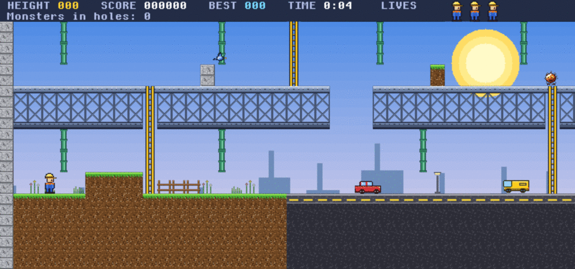

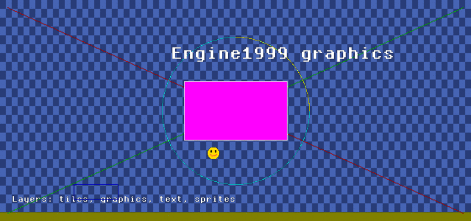

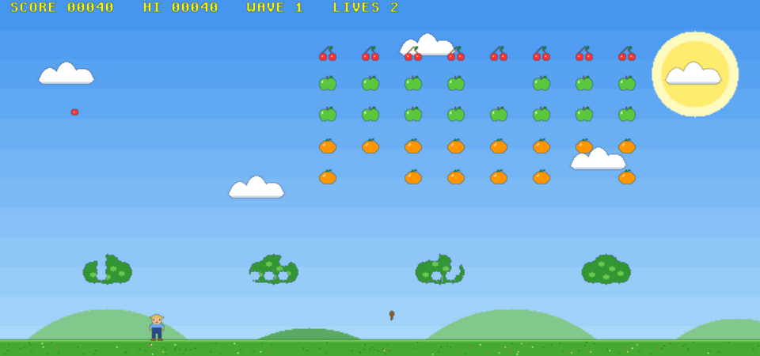

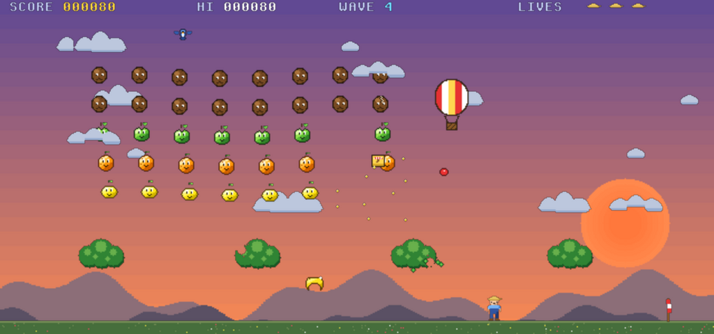

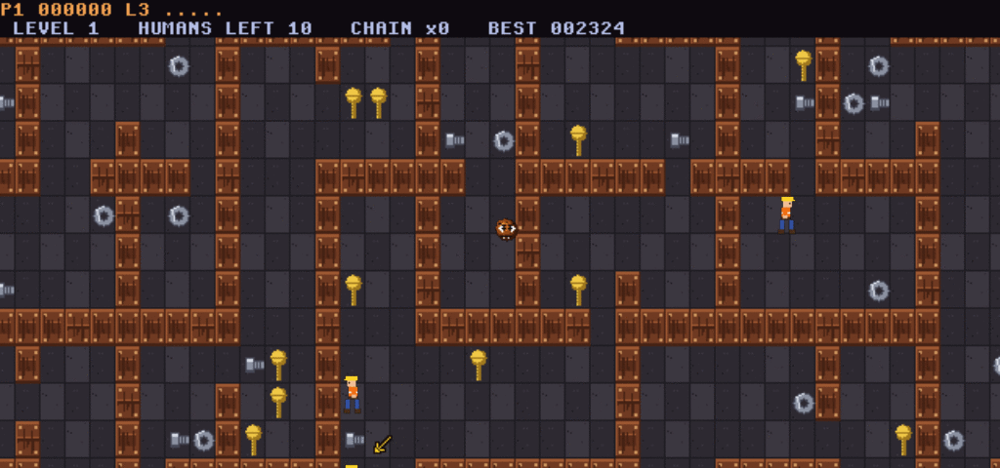

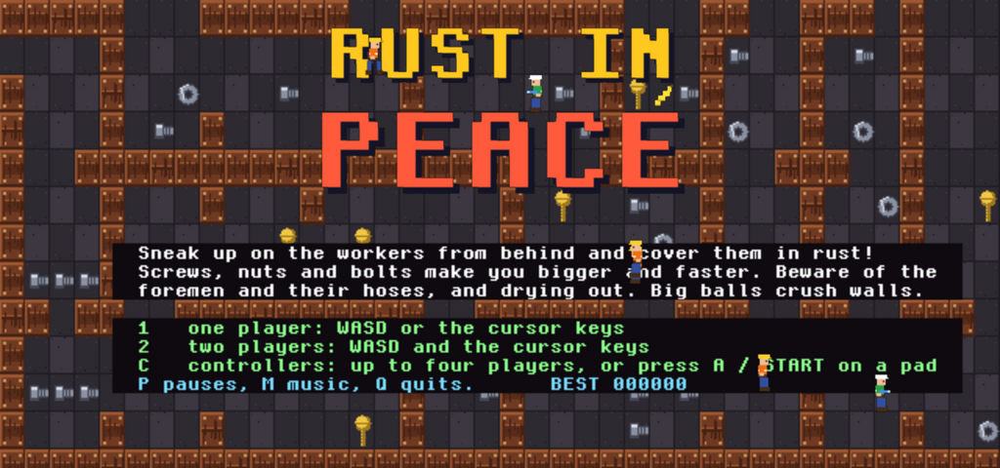

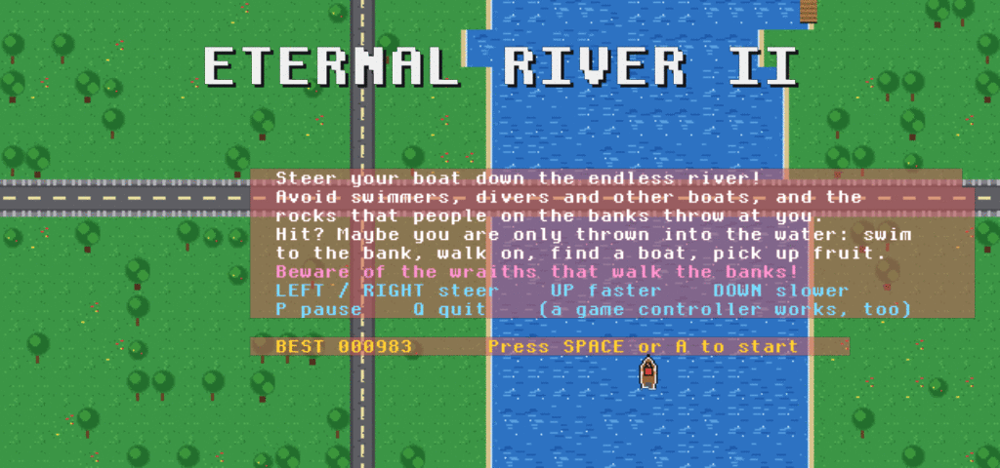

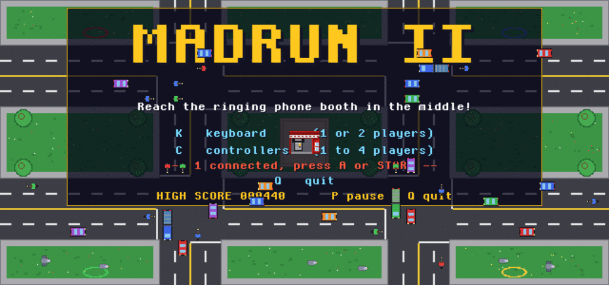

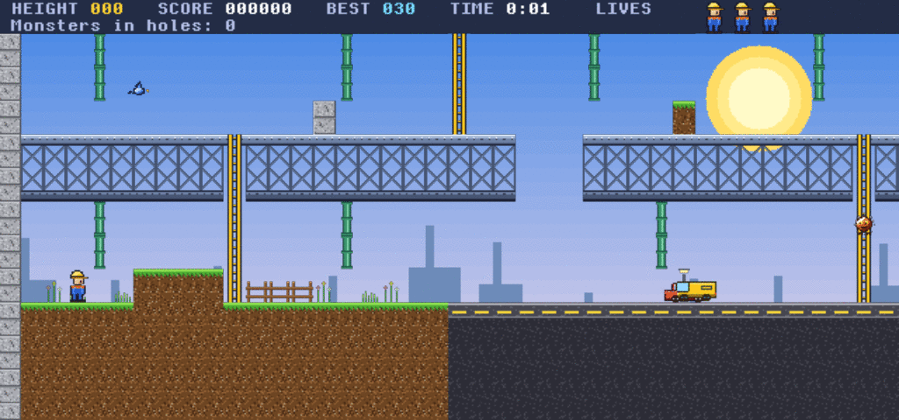

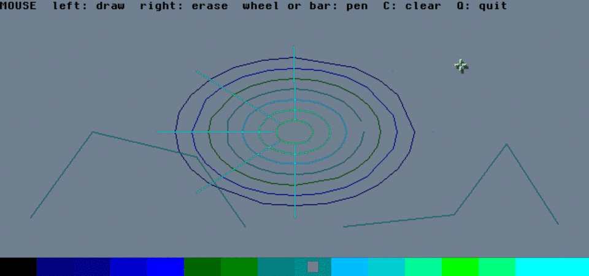

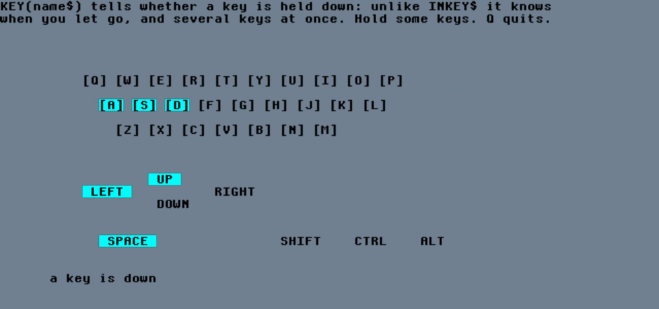

### 3D and demo scene

**Bug Hunt** and **Deqq's House II** use the software 3D sector renderer (`W3D`), which draws Doom-style worlds of sectors, portals and billboard things into a graphics layer. Bug Hunt is a first person shooter, Deqq's House II a stealth adventure in a crooked house with an alien who must not catch you:

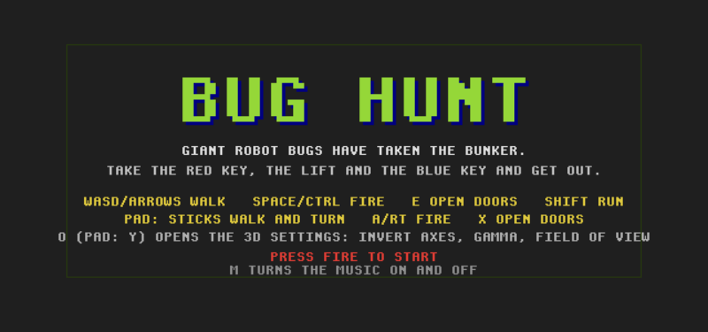

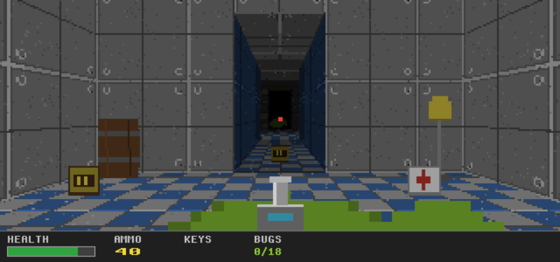

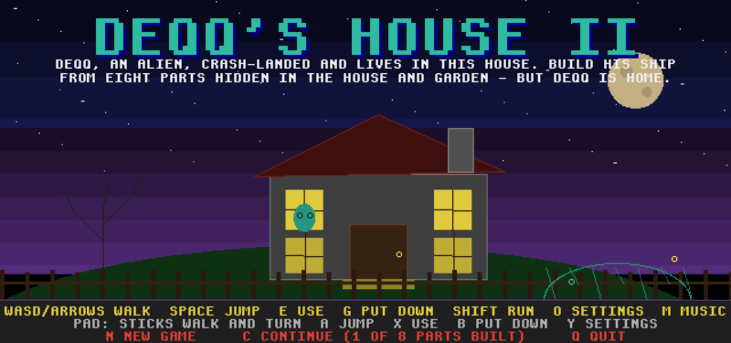

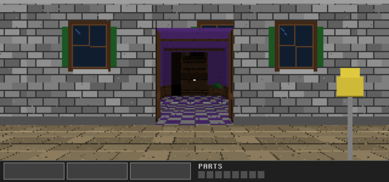

**Y2K Countdown** is a demo in the style of 1999, with copper bars, a starfield, a plasma, vector balls over a grid, a tunnel, a sine scroller and a millennium bug finale, to a chip tune that the program plays itself:

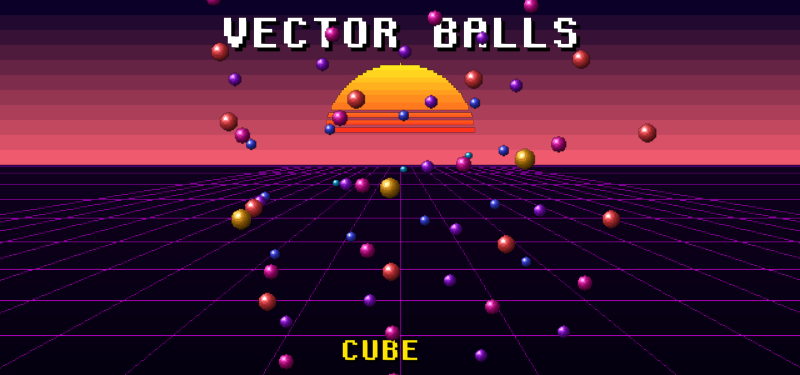

See [demos/README.md](demos/README.md) for all of them. The language is documented in [docs/basic-language.md](docs/basic-language.md).

## Standalone executables

```
LOAD "demos/orchard2"
BUILD "orchard2"
```

and `./orchard2` starts the game without the Engine. `BUILD` uses only the system linker (`ld`; no compiler is needed to build programs), finds what it needs on the system itself,
and links SDL2 and the C library dynamically, so the person who runs the program needs `libSDL2` installed. `BUILD "name", CONSOLE` makes a program without a window that needs **no SDL2 at all** (for servers and scripts: it reads standard input, writes standard output and returns its exit code). To build you need `ld` (binutils), the development files of the C library and SDL2, and `engine1999.o` and `engine.lib` next to `engine1999` (`make` leaves them there). See [docs/basic-language.md](docs/basic-language.md) (section `BUILD`).

## License

Engine1999 is free software under the **GNU General Public License, version 3 or later** ([LICENSE](LICENSE)), with an additional permission, the
**Engine1999 Runtime Exception** ([LICENSE-EXCEPTION](LICENSE-EXCEPTION)):

- **Programs you write in Engine1999 BASIC are yours.** The GPL does not apply to them, and you can license them as you like.
- **Executables made from them with `BUILD`** contain the Engine1999 runtime, but you may still distribute them under terms of your choice, as long as the runtime in them is the
  unmodified one and its notice stays (the executable shows it with `--engine1999-about`).
- Changes to the engine itself stay under the GPL. `SHOW COPYING` in the Engine prints the full terms; the demos start with four comment lines that repeat the conditions.

(The license text was drafted without a lawyer. If it matters for your project, have it reviewed.)

## Documentation

Start with [docs/README.md](docs/README.md). The most useful pages for programmers: the [language reference](docs/basic-language.md), the [syntax at a glance](docs/grammar.html),
[graphics](docs/graphics-subsystem.md), [sound](docs/sound.md), [files and devices](docs/io-subsystem.md).

## Contributing and credits

How the engine is built, how to run the tests and what conventions the code follows is in [docs/contributing.md](docs/contributing.md).

Engine1999 is written by **Ekkehard Morgenstern**, together with **Claude** (Claude Code, an AI coding assistant by Anthropic), which wrote a large part of the code and the documentation
under his direction. Everything Claude changed is recorded commit by commit in [HistoryLog-Claude.md](HistoryLog-Claude.md).

Contact: ekkehard@ekkehardmorgenstern.de
