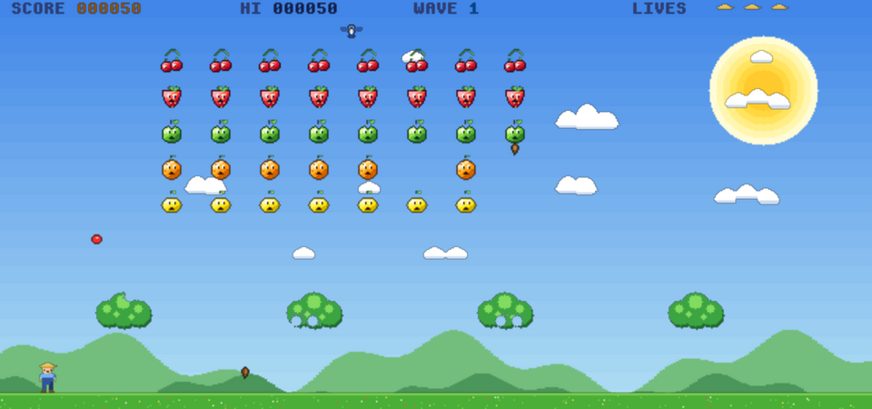

# Engine1999

A 2D game engine in C (SDL2) that behaves like a home computer of the late 1980s and early 1990s, and comes with its own BASIC to program it.
You type a program, `RUN` it, and it can use an 80x25 text screen, a tile layer, sprites and a free-drawing graphics layer, a software synthesizer, files and devices.
When it is done, `BUILD` turns it into a standalone executable.



> **Status: work in progress.** The engine and the language are still changing (statements may be renamed or reworked before a 1.0), and there are rough edges, but it is
> usable today, and the demos below show what it can do. If you like retro computing, BASIC or small games, you may find it useful already. Open work is listed in
> [docs/roadmap.md](docs/roadmap.md).

## What you get

- **A BASIC with line numbers and labels**, structured when you want it: `IF`/`ELSE`, `FOR`/`NEXT` (also `DOWNTO` and `FOR EACH`), `WHILE`, `REPEAT`, `EXIT`, `ITERATE`,
  procedures and functions with local variables and recursion (`PROC`, `FUNC`, `CALL`), `ON ERROR`/`RESUME`, `AFTER`/`EVERY` timers, `DATA`/`READ`, arrays up to six dimensions,
  binary-safe strings, `` `shell commands` `` as string literals. The whole syntax fits on one page: [docs/grammar.html](docs/grammar.html) ([text version](docs/grammar.md)).
- **Five display layers:** background, tiles, graphics, text and sprites, each with its own palette. Lines, circles, flood fill, `DRAW` strings, pictures defined in the program text
  with `DESIGN`, sprites with animation and collision detection, smooth scrolling. See [docs/graphics-subsystem.md](docs/graphics-subsystem.md).
- **Sound:** an eight channel synthesizer (sine, square, triangle and noise waves, envelopes, vibrato, glides). `PLAY "T120 O4 CDEFG"` plays music strings, `SOUND` and `SFX` make effects. See [docs/sound.md](docs/sound.md).
- **Files and devices:** `OPEN`, `PRINT #`, `LINE INPUT`, random access records, and drivers addressed like `mem:`, `sh:`, `tcp:`, `res:`. See [docs/io-subsystem.md](docs/io-subsystem.md).
- **Tools built in:** a full-screen editor (`EDIT`), a machine monitor with single-step and breakpoints (`MONITOR`), syntax colored `LIST`, `TRACE`, `STOP`/`CONT`, `RENUM`, `MERGE`, `CHAIN`.
- **`BUILD "name"`** makes a standalone Linux executable from your program (details below).
- **`engine1999c`**, a console version without a window for shell scripts and pipes: `engine1999c prog.bas` (also with a `#!` line), `echo 'PRINT 2^10' | engine1999c`, exit codes with `BYE n`. See [docs/console-host.md](docs/console-host.md).


## Try it

You need Linux, `gcc`, `make` and the SDL2 development files (on Debian and Ubuntu: `sudo apt install build-essential libsdl2-dev`). It is developed and tested on Debian 12 on x86-64.

```
make
./engine1999
```

`sudo make install` puts the programs, the demos, the documentation and the man pages (`man engine1999`, `man engine1999c`, `man engine1999-basic`) under `/usr/local`; with it, `BUILD` works from any directory.

You get a `Ready.` prompt, like a home computer of old. Type a program (ESC stops a running one):

```
10 PRINT "Hello from Engine 1999!"
20 FOR I=1 TO 3
30   SOUND 1,440*I,0.2
40 NEXT I
RUN
LIST
SAVE "hello"
```

Then try the demos: `LOAD "demos/fruit2"` and `RUN`.

| Demo | |
|---|---|
| `demos/fruit2.bas` | **Fruit Invaders II**, a Space Invaders style game with shaded sprites, a scrolling starfield, music and effects (keys: A/D move, SPACE fires, P pauses, Q quits) |
| `demos/climb.bas` | **The Long Climb**, a jump and run game: climb a steel tower, drill holes to trap monsters, reach the ice cream stand on the roof |
| `demos/fruit.bas` | The first, simpler Fruit Invaders |
| `demos/gfx.bas` | The graphics layers: palettes, drawing, tiles, `DESIGN` pictures, sprites |
| `demos/sfx.bas`, `demos/ode.bas`, `demos/prelude.bas` | A sound effect board; Beethoven's "Ode to Joy" and Bach's "Prelude in C" |


See [demos/README.md](demos/README.md) for all of them. The language is documented in [docs/basic-language.md](docs/basic-language.md).

## Standalone executables

```
LOAD "demos/fruit2"
BUILD "fruit2"
```

and `./fruit2` starts the game without the Engine. `BUILD` uses only the system linker (`ld`; no compiler is needed to build programs), finds what it needs on the system itself,
and links SDL2 and the C library dynamically, so the person who runs the program needs `libSDL2` installed. `BUILD "name", CONSOLE` makes a program without a window that needs **no SDL2 at all** (for servers and scripts: it reads standard input, writes standard output and returns its exit code). To build you need `ld` (binutils), the development files of the C library and SDL2, and `engine1999.o` and `engine.lib` next to `engine1999` (`make` leaves them there). See [docs/basic-language.md](docs/basic-language.md) (section `BUILD`).

## License

Engine1999 is free software under the **GNU General Public License, version 3 or later** ([LICENSE](LICENSE)), with an additional permission, the
**Engine1999 Runtime Exception** ([LICENSE-EXCEPTION](LICENSE-EXCEPTION)):

- **Programs you write in Engine1999 BASIC are yours.** The GPL does not apply to them, and you can license them as you like.
- **Executables made from them with `BUILD`** contain the Engine1999 runtime, but you may still distribute them under terms of your choice, as long as the runtime in them is the
  unmodified one and its notice stays (the executable shows it with `--engine1999-about`).
- Changes to the engine itself stay under the GPL. `SHOW COPYING` in the Engine prints the full terms; the demos start with four comment lines that repeat the conditions.

(The license text was drafted without a lawyer. If it matters for your project, have it reviewed.)

## Documentation

Start with [docs/README.md](docs/README.md). The most useful pages for programmers: the [language reference](docs/basic-language.md), the [syntax at a glance](docs/grammar.html),
[graphics](docs/graphics-subsystem.md), [sound](docs/sound.md), [files and devices](docs/io-subsystem.md).

## Contributing and credits

How the engine is built, how to run the tests and what conventions the code follows is in [docs/contributing.md](docs/contributing.md).

Engine1999 is written by **Ekkehard Morgenstern**, together with **Claude** (Claude Code, an AI coding assistant by Anthropic), which wrote a large part of the code and the documentation
under his direction. Everything Claude changed is recorded commit by commit in [HistoryLog-Claude.md](HistoryLog-Claude.md).

Contact: ekkehard@ekkehardmorgenstern.de
